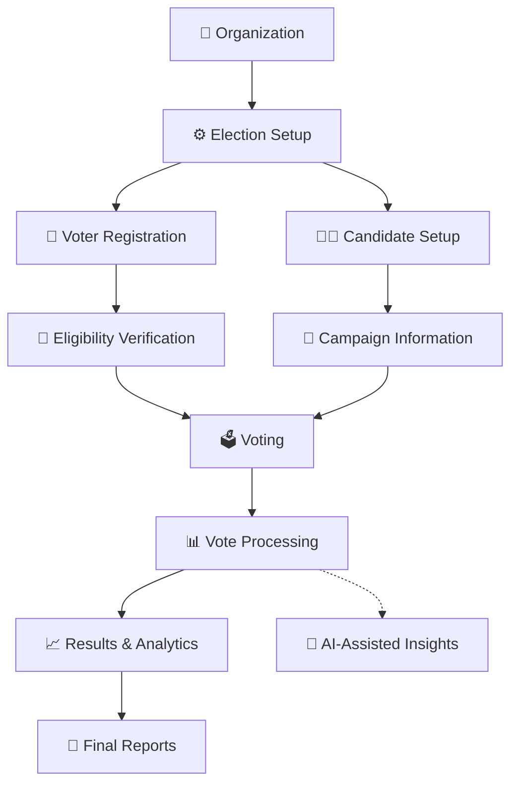

# 🗳️ SmartVote AI

<p align="center">
  
</p>

<p align="center">
  
</p>

<p align="center">
  <strong>Secure. Transparent. Intelligent.</strong>
  <br />
  A modern platform for digital elections, voter management, campaign experiences, election analytics, and AI-assisted administration.
</p>

<p align="center">
  
  
  
  
  
</p>

---

## ✨ The Vision

SmartVote AI is designed to modernize how organizations plan, manage, and monitor elections.

From student leadership elections to organizational voting, the platform aims to bring election workflows into one accessible digital environment.

**One platform. One organized election process. Smarter decision support.**

## 🌐 Designed For

- 🎓 Universities and colleges
- 🏛️ Student governments and associations
- 🏢 Companies and professional organizations
- 🤝 NGOs and community groups
- 👥 Clubs and membership organizations
- 🌍 Institutions seeking modern election-management tools

## 🚀 Platform Capabilities

| Module | Purpose |
|---|---|
| 🗳️ Election Management | Organize election details, schedules, positions, and statuses |
| 👥 Voter Management | Manage voter registration and eligibility workflows |
| 🧑‍💼 Candidate Profiles | Organize candidate information and manifestos |
| 📢 Campaign Center | Present candidate priorities and campaign information |
| 📊 Analytics Dashboard | Visualize participation and election statistics |
| 🤖 AI Assistant | Support administrative queries and data summaries |
| 🔐 Access Control | Structure administrative permissions and user roles |
| 🧾 Audit & Reporting | Support traceability and election reporting |

*The table describes the intended platform capabilities. Actual availability depends on the implemented code and configured services.*

---

## 🧭 How It Works



---

## 🤖 AI-Powered Intelligence

SmartVote AI integrates with Google's Gemini ecosystem through the `@google/genai` package.

Potential AI-assisted workflows include:

- Natural-language administrative assistance
- Election data summaries
- Report drafting
- Statistical explanations
- Candidate information summaries
- Election participation insights

### AI With Clear Boundaries

AI must not independently determine official election outcomes or alter authoritative vote records.

Official vote counting should rely on validated data and deterministic application logic. Sensitive administrative actions must require explicit authorization.

---

## 🏗️ Technology Stack

<p align="center">
  
</p>

- **React 19** — Component-based user interface
- **TypeScript** — Type-safe development
- **Vite** — Development server and frontend build tooling
- **Express** — Node.js server framework
- **Tailwind CSS 4** — Responsive styling
- **Lucide React** — Interface icons
- **Motion** — Interface animation
- **Google Gemini** — AI integration

---

## 📁 Project Structure

The current repository is organized around a React frontend and an Express server.

```text
smartvote-platform/
├── src/
│   ├── App.tsx
│   ├── main.tsx
│   ├── index.css
│   └── types.ts
├── assets/
├── server.ts
├── index.html
├── metadata.json
├── package.json
├── tsconfig.json
├── vite.config.ts
├── .env.example
└── README.md
```

The structure may evolve as additional features are separated into reusable components, services, and modules.

---

## ⚡ Quick Start

### Requirements

- Node.js compatible with the project dependencies
- npm
- Git

### 1. Clone the repository

```bash
git clone https://github.com/johncharlessarwi-dot/smartvote-platform.git
```

### 2. Enter the project directory

```bash
cd smartvote-platform
```

### 3. Install dependencies

```bash
npm install
```

### 4. Configure environment variables

Create a local environment file from the provided example.

```bash
cp .env.example .env
```

On Windows PowerShell:

```powershell
Copy-Item .env.example .env
```

Configure the required variables using the names expected by the application.

Never commit real API keys, authentication secrets, or database credentials.

### 5. Start development

```bash
npm run dev
```

### 6. Build for production

```bash
npm run build
```

### 7. Run production

```bash
npm start
```

Check `package.json` to confirm the available commands and scripts for your version of the project.

---

## 🔐 Security Principles

Digital election systems require careful security engineering.

SmartVote AI's production design should prioritize:

- Server-side authentication and authorization
- Role-based access control
- Secure session management
- Voter eligibility validation
- Duplicate-vote prevention
- Protected election records
- Input validation and rate limiting
- Audit logs for sensitive administrative operations
- Data privacy and appropriate retention
- Secure backups and recovery procedures
- Independent security testing before high-stakes elections

**Important:** Hiding a button in the frontend is not authorization. Every sensitive operation must be checked by the server.

## 📊 Election Analytics

Useful election metrics can include voter turnout and candidate vote share.

Voter turnout:

\[
\text{Turnout}=\frac{\text{Votes Cast}}{\text{Eligible Voters}}\times100
\]

Candidate vote share:

\[
\text{Vote Share}=\frac{\text{Candidate Votes}}{\text{Total Valid Votes}}\times100
\]

These calculations must use validated election records and clearly defined counting rules.

---

## 🗺️ Development Roadmap

- [ ] Election configuration and lifecycle management
- [ ] Organization management
- [ ] Candidate and position management
- [ ] Voter registration and eligibility verification
- [ ] Secure vote submission
- [ ] Duplicate-vote protection
- [ ] Election analytics and reporting
- [ ] Role-based permissions
- [ ] Audit and monitoring tools
- [ ] AI-assisted reporting
- [ ] Accessibility and usability testing
- [ ] Load and security testing

This roadmap describes development goals, not a claim that every feature is already implemented.

---

## 🌍 Our Mission

To make election management more accessible, organized, transparent, and efficient through thoughtful software engineering.

We envision a future where institutions can manage election preparation, voter participation, candidate information, and election reporting through a unified digital platform.

---

## 👨‍💻 Project Creator

**John Charles Sarwi**

Project: **SmartVote AI**

GitHub: [johncharlessarwi-dot](https://github.com/johncharlessarwi-dot)

Repository: [smartvote-platform](https://github.com/johncharlessarwi-dot/smartvote-platform)

---

<p align="center">
  
</p>

<p align="center">
  <strong>SMARTVOTE AI</strong>
  <br />
  <em>Intelligent Election Management for a Digital World.</em>
</p>
