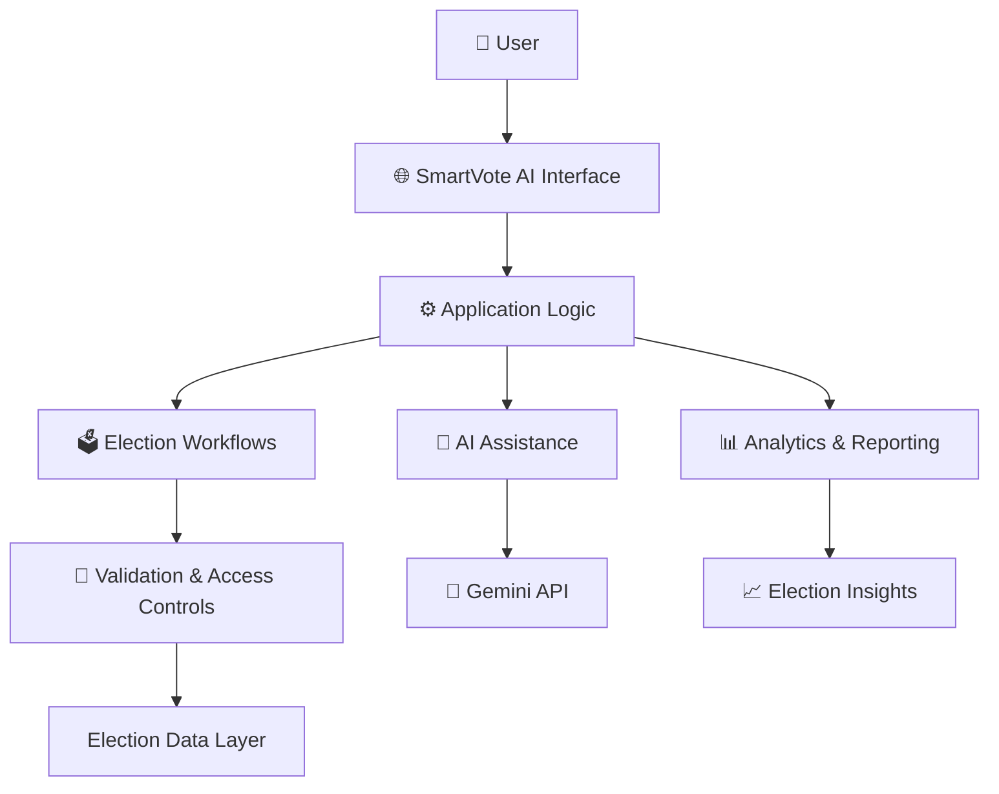

 
<div align="center">


<br/>


<br/><br/>

**A modern platform concept for election management, digital voting workflows, and AI-assisted election insights.**

[Explore Repository](https://github.com/johncharlessarwi-dot/smartvote-platform) · [Report a Bug](https://github.com/johncharlessarwi-dot/smartvote-platform/issues) · [Request a Feature](https://github.com/johncharlessarwi-dot/smartvote-platform/issues)

</div>

---

## ⚡ The Vision

SmartVote AI explores how modern software and artificial intelligence can improve election administration, simplify election workflows, and make election information easier to understand.

The project combines a modern web interface with AI-assisted functionality to explore a more accessible and transparent digital election experience.

<div align="center">


</div>

## ✨ Core Platform Concepts

<table>
<tr>
<td width="50%">

### 🗳️ Digital Voting
- Digital voting workflow concepts
- Voter-facing user experiences
- Clear election navigation
- Election participation interfaces

</td>
<td width="50%">

### 🧠 Artificial Intelligence
- AI-assisted election information
- Natural-language interactions
- Election data interpretation
- Intelligent assistant concepts

</td>
</tr>
<tr>
<td width="50%">

### 📊 Election Analytics
- Results visualization concepts
- Election statistics
- Participation insights
- Data-driven reporting

</td>
<td width="50%">

### 🔐 Security & Trust
- Authentication design considerations
- Role-based access concepts
- Data validation
- Auditability and integrity principles

</td>
</tr>
</table>

> **Important:** These are platform goals and design concepts. Confirm each feature against the current source code before presenting it as implemented. This README alone does not establish that the system is production-ready or that it conducts secure elections.

---

## 🎬 Animated Project Showcase

<div align="center">


</div>

### 🛠️ Technology Stack

<div align="center">

| Technology | Purpose |
|---|---|
| React 19 | Component-based user interface |
| TypeScript 5.8 | Type-safe application development |
| Vite 6 | Development server and build tooling |
| Tailwind CSS 4 | Utility-first styling |
| Express 4 | Backend API framework |
| Google GenAI SDK | Gemini AI integration |
| Motion | Interface animation |
| Lucide React | Icon library |

</div>

<div align="center">


</div>

*Technology icons are provided by an external image service.*

---

## 🧩 How the Platform Fits Together



The diagram represents a conceptual architecture. Actual connections, persistence, and security controls depend on the implementation in the repository.

---

## 🚀 Getting Started

### Prerequisites

- Node.js and npm
- Git
- A Google Gemini API key if the AI functionality is enabled

### 1. Clone the repository

```bash
git clone https://github.com/johncharlessarwi-dot/smartvote-platform.git
cd smartvote-platform
```

### 2. Install dependencies

```bash
npm install
```

### 3. Configure environment variables

Check the project files for the environment variable names expected by the application. If the app uses Gemini, create the appropriate local environment file and configure the required API key.

Example only:

```env
GEMINI_API_KEY=your_api_key_here
```

**Security:** Never commit real API keys or other secrets to GitHub. Keep privileged API calls on the server when required by your architecture.

### 4. Start the development server

```bash
npm run dev
```

Use the scripts defined in `package.json` as the source of truth for available development, build, and test commands.

---

## 🔒 Security Comes First

Election-related software needs much stronger safeguards than a typical demonstration application.

- **Identity:** Establish reliable authentication and eligibility checks.
- **Authorization:** Enforce permissions on the server, not only in the interface.
- **Integrity:** Protect election records against unauthorized changes.
- **Auditability:** Maintain appropriate, tamper-resistant audit records.
- **Privacy:** Minimize personal data and protect sensitive voter information.
- **AI boundaries:** AI-generated explanations must never be treated as authoritative election results.
- **Testing:** Test security, accessibility, failure recovery, and edge cases.

**Production warning:** Do not use this project to conduct a real election without independent security assessment, appropriate legal and operational review, and verified election-integrity safeguards.

---

## 🗺️ Development Roadmap

<div align="center">


</div>

- [ ] Verify and document existing functionality
- [ ] Improve responsive layouts and accessibility
- [ ] Add and test reliable error handling
- [ ] Verify authentication and server-side authorization
- [ ] Improve AI response validation and failure handling
- [ ] Add automated tests for critical workflows
- [ ] Document deployment and environment configuration
- [ ] Conduct independent security reviews before real-world election use

---

## 📂 Project Structure

The exact folder layout may evolve. Review the current repository before relying on this example.

```text
smartvote-platform/
├── src/                 # Frontend application source
├── public/              # Public static assets
├── server/              # Backend code, if present
├── package.json         # Project scripts and dependencies
├── tsconfig.json        # TypeScript configuration
├── vite.config.ts       # Vite configuration
└── README.md            # Project documentation
```

---

## 🌍 Why SmartVote AI?

Technology should make complex processes easier to understand, improve access to information, and support responsible decision-making.

SmartVote AI is an exploration of those principles through modern web development, AI-assisted interaction, and election-management concepts.

<div align="center">


</div>

---

## 👨‍💻 Project Creator

<div align="center">

### **John Charles Sarwi**

Software Developer · Computer Science Student · Founder of JOHN ONLINE SERVICES AND APPLICATIONS

[](https://github.com/johncharlessarwi-dot)
[](https://github.com/johncharlessarwi-dot/smartvote-platform)

**Designed to explore smarter election workflows through technology and responsible AI.**

</div>

---

<div align="center">


**⭐ Explore the code. Share feedback. Help improve the project.**

<sub>Created by JOHN ONLINE SERVICES AND APPLICATIONS</sub>

</div>
